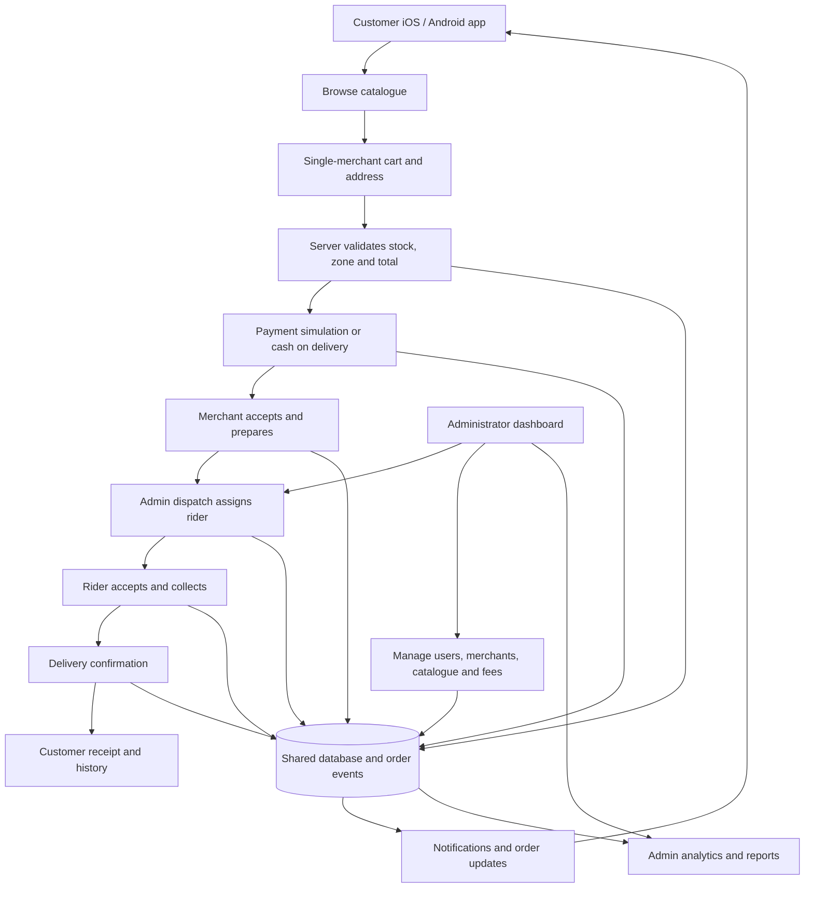

# Yebbo
### Your city. Delivered.

**A Zambia-focused local delivery marketplace planned for downloadable iOS and Android apps.**

Yebbo connects customers with nearby restaurants and grocery shops, with riders completing deliveries and administrators overseeing the service. The first release focuses on a small Lusaka service area, transparent prices in Zambian kwacha (ZMW), clear delivery instructions, and reliable order updates.

> **Status:** Planning stage. This repository contains an execution blueprint, not a working application. No store downloads, live payment integrations, or merchant partnerships exist yet. The pilot location, technology choices, and dates below are planning assumptions for the group to validate.

## 1. Identity and inspiration

**Working name: Yebbo.** Short, memorable, and flexible enough for a brand that starts in Zambia and could expand. Suggested tagline: **Your city. Delivered.**

Alternatives for a group vote:

| Name | Intended brand idea |
| --- | --- |
| Yebbo | Friendly, energetic working identity; recommended default |
| TumaGo | A send-and-go concept |
| Nabo | A short, neighbourhood-oriented identity |

These are naming ideas, not verified translations or cleared trademarks. Check business names, trademarks, domains, social handles, app-store listings, and local-language associations before choosing the final identity. Zambian origins are a product strength; service quality and execution should define the brand.

The product takes inspiration from the Glovo service the group has identified in Kenya. For factual accuracy, Glovo was founded in Barcelona in 2015, not Kenya ([Glovo company history](https://about.glovoapp.com/press/glovo-celebrates-10-years/)). Yebbo is an independent student project with its own design and implementation, with no Glovo affiliation.

## 2. Problem, audience, and business model

**Problem hypothesis:** Customers need a convenient way to order from nearby businesses, while smaller merchants need a manageable online ordering channel. Riders need clear collection and delivery instructions.

Validate this with at least five potential customers, two merchants, and two riders in week one. Record findings and change the scope if the evidence disagrees.

**Initial audience:** Students, workers, households, restaurants, and small grocery shops inside one agreed Lusaka delivery zone.

**Proposed value:**

- Browse available products and see the full cost before ordering.
- Use a map pin, landmark, contact number, and delivery notes together.
- Follow an order from merchant acceptance through delivery.
- Give merchants a simple order queue and administrators an auditable overview.
- Support slower connections through small images, cached browsing, and explicit retry states.

**E-commerce model:** A marketplace facilitating sales from merchants to customers. Proposed revenue is a disclosed merchant commission plus a customer delivery fee. Rates remain undecided until merchant interviews and cost estimates are complete.

Illustrative calculation only: ZMW 150 basket + ZMW 20 delivery = ZMW 170 charged. At an assumed 10% merchant commission, merchant payable is ZMW 135 and platform gross revenue is ZMW 35 before rider pay, payment fees, refunds, support, and other costs. Merchandise value is not platform revenue. No claim of profitability is made.

## 3. Scope: finish one complete delivery journey

### Required MVP

| User | Functions | Completion evidence |
| --- | --- | --- |
| Customer | Sign up/sign in, browse/search shops and products, manage a single-shop cart, set address, see fees, place order, track status, view receipt/history, request help | Complete an order on an Android phone and an iPhone |
| Merchant | View incoming orders, accept/reject with reason, update product availability, mark orders ready | An accepted order reaches the dispatch queue |
| Rider | See assigned jobs, accept a job, view pickup/drop-off details, mark collection and delivery | A delivery updates the customer view and analytics |
| Administrator | Approve/manage merchants and riders, manage categories/zones/fees, assign riders, inspect orders, handle cancellations/refunds, suspend accounts | Changes are authorized and recorded in an audit log |
| Administrator analysis | Date-filtered summary cards, daily order/revenue tables, merchant performance, cancellation reasons, CSV export | Figures match a known seeded dataset |

Customer and rider experiences will use the shared mobile codebase with server-controlled roles. Merchant and administrator interfaces will be responsive web dashboards to reduce mobile-store scope. Customers cannot grant themselves merchant, rider, or administrator privileges.

### Payment scope

For the assessed demo, implement clearly labelled simulated mobile-money payments plus a cash-on-delivery workflow. A simulation must never request real mobile-money credentials or move real funds.

For a commercial pilot, evaluate payment providers supporting the required Zambian mobile-money networks, such as Airtel Money and MTN MoMo, and cards where practical. Availability, onboarding, settlement, refunds, fees, and sandbox access must be verified with the selected provider. These are candidate integrations, not confirmed capabilities.

### Later releases

Multi-merchant carts, automated route optimization, live background rider location, subscriptions, loyalty points, in-app chat, multiple cities, and parcel errands. Medicine, alcohol, and other regulated categories are outside the initial scope.

## 4. How the functions connect



The backend is the source of truth. Customer, merchant, rider, and administrator interfaces read the same authorized order records. Every accepted status change records an event used by tracking, notifications, and analytics.

### Order and payment rules

Main order path:

`PLACED -> ACCEPTED -> PREPARING -> READY_FOR_PICKUP -> ASSIGNED -> PICKED_UP -> DELIVERED`

A merchant can move a placed order to `REJECTED`. Eligible orders can move to `CANCELLED`; after pickup, delivery problems go through an administrator support flow. A customer may cancel before merchant acceptance; later cancellation requires administrator review and a recorded reason.

Payment status is separate: `PENDING / PAID / FAILED / REFUND_PENDING / REFUNDED`. Cash orders remain pending until collection is confirmed. Cancelling an order does not by itself prove that a refund succeeded.

- The server calculates prices and delivery fees, checks availability, and snapshots order-item prices.
- Reserve available stock transactionally on placement and release reservations on rejection/cancellation.
- Reject requests outside the delivery zone and stale/unavailable products before committing an order.
- Use idempotency keys so retries cannot create duplicate orders or payment requests.
- Allow only one active rider assignment per order; use a transaction to prevent competing assignments.
- Enforce permitted status transitions and actor roles on the server.
- For future real payments, verify signed provider callbacks, deduplicate events, and reconcile transactions. Never trust a success screen as proof of payment.
- Show the last confirmed state after a connection failure; retries must be safe.

## 5. Proposed technical architecture

Keep one backend and one shared database for the student MVP.

| Layer | Proposed choice | Purpose |
| --- | --- | --- |
| Mobile | React Native, Expo, TypeScript | Share customer/rider application code across Android and iOS |
| Merchant/admin web | React with Vite and TypeScript | Simple responsive dashboards |
| Backend | Supabase Auth, PostgreSQL, Storage, Realtime, and server functions | Authentication, relational records, product images, updates, and protected business operations |
| Maps | Provider to be chosen after coverage/cost testing | Address pin and route links; text/landmark entry remains available |
| Notifications | Expo notifications, with in-app refresh fallback | Order updates without making push delivery essential |
| Builds and distribution | Expo EAS Build and Submit | Signed mobile builds and uploads to store distribution systems |
| Collaboration | GitHub issues, branches, pull requests, and Actions | Task tracking, review, automated validation |

This is a proposal, not an installed stack. Select compatible supported versions during setup and commit the lockfile. Confirm the team's TypeScript experience in week one.

All critical mutations must run in protected server functions or transactional database procedures. Apply row-level security: customers see their own orders; merchants see their store's orders; riders see assigned jobs; administrators use audited privileged operations. Never embed a service-role key in an app.

### Core data model

- `profiles`, `user_roles`: identity, account state, and privileged role assignments.
- `merchants`, `merchant_members`, `categories`, `products`: shops, ownership, catalogue, prices, and availability.
- `addresses`, `delivery_zones`: customer instructions and supported areas.
- `orders`, `order_items`: customer, merchant, totals, item snapshots, delivery address snapshot, and status.
- `payments`, `refunds`: method, external reference when applicable, amount, and reconciliation state.
- `rider_assignments`, `order_events`: assignment history, timestamps, actors, and status changes.
- `support_tickets`, `audit_logs`: support activity and administrative changes.

A customer has many orders; an MVP order belongs to exactly one merchant and has many order items. An order can have payment attempts and assignment history but only one active rider assignment. Store money as integer ngwee and timestamps in UTC; display dates in Africa/Lusaka.

### Planned repository layout

```text
apps/
  mobile/          # Customer and rider mobile experience
  dashboard/       # Merchant and administrator web interface
packages/
  shared/          # Shared types, validation, and domain rules
supabase/
  migrations/      # Tables, constraints, access rules, reporting queries
  functions/       # Protected order, dispatch, and payment operations
  seed.sql         # Fictional demonstration data
docs/
  requirements.md
  architecture.md
  test-plan.md
  submission-summary.md
.github/
  workflows/       # Checks added when application code exists
README.md
```

Only the README and repository housekeeping are provided at this stage. The tree above is the intended structure, not a claim that those files exist. Setup commands will be added alongside the actual implementation.

## 6. Administrator analysis

Reports must use the same stored events and payment records as operational screens.

| Measure | Definition |
| --- | --- |
| Orders placed | Orders created in the selected reporting period |
| Completed orders | Orders delivered during the selected period |
| Delivered merchandise value | Sum of item subtotals for delivered orders in the period |
| Platform gross revenue | Earned commission plus delivery fees for delivered orders, adjusted for relevant refunds; excludes merchant pass-through value |
| Completion rate | Delivered orders divided by orders placed in the selected creation-date cohort |
| Cancellation rate | Cancelled orders divided by orders placed in that cohort; report merchant rejection separately |
| Average delivery duration | Mean delivered-at minus placed-at for delivered orders in the period |
| Merchant performance | Delivered orders, merchandise value, and rejection counts per merchant |

Show empty states, reporting timezone, and date filters. State the cohort basis next to rate metrics. Restrict financial exports to administrators and avoid unnecessary customer contact details.

## 7. Execution plan and team ownership

The brief is dated **4 September 2026** and says presentation is two months later, implying **4 November 2026**; confirm the actual slot with the lecturer. This eight-week plan runs from 14 September to the presentation window. For a full-time group of five, assign names to these responsibilities:

| Lead | Responsibility |
| --- | --- |
| Member 1: product and coordination | Requirements, interviews, backlog, scope, documentation, presentation |
| Member 2: mobile | Customer journey, rider screens, device testing |
| Member 3: backend | Database, authentication, order rules, access control |
| Member 4: dashboard | Merchant operations, administrator tools, analytics |
| Member 5: quality and release | Test data, integration checks, CI, builds, defect tracking |

These are leads, not silos: every deliverable has an implementer and another member reviewing it.

| Week | Dates | Deliverable | Exit condition |
| --- | --- | --- | --- |
| 1 | Sep 14-20 | Interviews, scope, user stories, wireframes, roles, developer-account feasibility | Group agrees MVP; test phone access and distribution route identified |
| 2 | Sep 21-27 | Project setup, schema, authentication, permissions, seeded catalogue | Customer cannot read another customer's order; merchant cannot edit another shop |
| 3 | Sep 28-Oct 4 | Browse, cart, address, server pricing, order placement | A persisted order is created safely, including retry and unavailable-item cases |
| 4 | Oct 5-11 | Payment simulation, cash workflow, merchant acceptance and preparation | Paid simulation, failed simulation, and rejection cases work |
| 5 | Oct 12-18 | Dispatch, rider flow, order updates, notifications | Complete one end-to-end delivery on both mobile platforms |
| 6 | Oct 19-25 | Admin management, reports, support and cancellation flows | Seeded financial figures reconcile; role restrictions pass |
| 7 | Oct 26-Nov 1 | Device QA, accessibility, slow-network tests, beta builds, documentation draft | Installable builds tested; critical defects fixed; demo rehearsed |
| 8 | Nov 2-4 | Feature freeze, final regression, submission summary, presentation | Stable demo, backup recording, and final evidence ready |

Public store approval is an external dependency and is not guaranteed by the assessment date. Begin developer-account preparation early; prioritize a reliable assessed build before expanding scope.

## 8. Testing and definition of done

A feature is done when reviewed, integrated, tested with appropriate permissions and failure cases, and reflected in the documentation.

Release checks:

- [ ] Customer-to-delivery journey passes on a physical Android phone and iPhone.
- [ ] Duplicate taps/network retries create one order.
- [ ] Unauthorized reads, price changes, role changes, and status transitions are blocked.
- [ ] Out-of-stock products, out-of-zone addresses, rejection, cancellation, and payment failure are handled.
- [ ] Two dispatch attempts cannot allocate two active riders to one order.
- [ ] Cash collection and simulated payments are visibly distinguished.
- [ ] Reports reconcile against manually calculated fixtures, including refunds and date boundaries.
- [ ] Slow/offline states preserve the cart and show clear recovery options.
- [ ] Screens support readable contrast, meaningful labels, large touch targets, and larger text.
- [ ] Sensitive details and secrets do not appear in logs or source control.
- [ ] Database backup and restore are exercised before a real pilot.

Use unit tests for pricing and state transitions, integration tests for database access and transaction rules, and a small set of end-to-end tests for the complete ordering journey. Add linting, type checks, and tests to pull requests once code exists.

## 9. Becoming downloadable on iOS and Android

A mobile website or Expo Go preview alone does not satisfy the final downloadable-app goal.

1. Establish team-controlled Expo, Apple Developer, and Google Play Console accounts, ownership, signing access, and a budget.
2. Choose unique permanent bundle/package identifiers and app assets after naming checks.
3. Produce signed Android and iOS builds using development, preview, and production profiles.
4. Test Android through an installable preview build/internal testing track and iOS through TestFlight.
5. Prepare screenshots, descriptions, support/privacy pages, age/content declarations, data disclosures, and review credentials where required. Implement account deletion and appropriate location-permission explanations.
6. Verify current store testing and review requirements for the actual developer accounts.
7. Upload builds, submit them for review, resolve feedback, and release approved versions.
8. Add verified App Store and Google Play download links here after publication.

Expo documents both-platform builds and submission, but uploading an iOS build to TestFlight is distinct from submitting it for public App Review ([build guide](https://docs.expo.dev/deploy/build-project/), [submission guide](https://docs.expo.dev/submit/ios/)).

## 10. Pilot operations, costs, and open decisions

Start with fictional data for the assessment. A proposed real pilot is one delivery zone, three to five participating merchants, and a small rider group, subject to validation.

Before accepting real orders, assign responsibility for merchant onboarding, rider verification and training, opening hours, service radius, packaging, support escalation, failed deliveries, cash reconciliation, settlement, and refunds. Obtain relevant local business, privacy, payment, and operational advice before commercial launch.

Prepare a cost worksheet covering developer accounts, hosting/database/storage, builds, maps, notifications/SMS, payment fees, rider compensation, support, and promotion. Obtain current quotes instead of treating the demo as a cost-free business.

Open decisions:

- [ ] Confirm Yebbo or another cleared name.
- [ ] Confirm group members, actual presentation date, and pilot neighbourhood.
- [ ] Validate demand and agree delivery radius, fees, and merchant commission.
- [ ] Confirm devices, account ownership, and project budget.
- [ ] Select mapping and payment providers after access and coverage checks.
- [ ] Agree data retention, user support, and commercial launch responsibilities.

## 11. BIT301 assessment alignment

Source: local assignment brief, **Practical 2026.pdf**, dated 04/09/2026.

| Requirement | Planned evidence |
| --- | --- |
| Useful societal service | Validated local ordering and delivery problem |
| User interface | Customer ordering and tracking app |
| Administrator interface | Account, catalogue, dispatch, and order management |
| Administrator analysis | Date-filtered tables, statistics, and reports |
| Functions and their relationships | Diagram in section 4 and end-to-end demonstration |
| Maximum two pages of documentation | Separate condensed submission summary with a diagram |
| Group presentation | Shared demo with each member explaining their contribution |

**This README is the full internal blueprint, not the two-page assessed submission.** Create a separate summary of at most two rendered pages before submission, explaining the functions and their connections and including the diagram.

Suggested presentation: problem and audience -> customer order -> merchant acceptance -> rider delivery -> administrator analytics -> architecture and testing -> limitations and next steps.

## 12. Working agreement and first tasks

Use short feature branches and focused pull requests. Each issue should state the user outcome, owner, acceptance criteria, dependencies, and target week. Keep secrets in local environment configuration or managed secrets storage; commit examples containing placeholders only.

Initial backlog:

1. Confirm scope, team roles, presentation date, and interview findings.
2. Draw and review customer, merchant, rider, and administrator wireframes.
3. Initialize the mobile app, dashboard, and backend structure.
4. Implement schema, access policies, and fictional seed data.
5. Build the first complete slice: catalogue -> cart -> order -> admin visibility.
6. Add merchant preparation and rider delivery.
7. Add payment simulation, cancellation handling, and reconciled analytics.
8. Produce device-tested builds, the two-page submission, and presentation evidence.

**Licensing:** No open-source license selected yet. Agree ownership and licensing as a group before offering reuse rights.

---
Planning baseline: 14 September 2026. Update this document as assumptions are validated and features ship.
