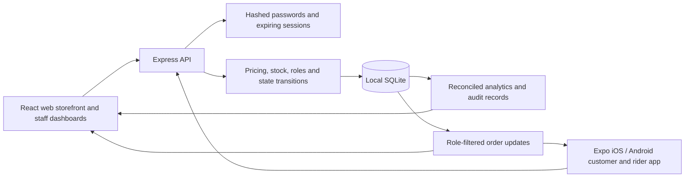

# Architecture and business rules

## Local-first implementation decision

The original blueprint proposed hosted Supabase. On 30 September 2026, the owner chose **keep the backend local for now**. This implementation therefore uses an Express API, SQLite persistence and server-enforced permissions. No Supabase project was created. The original plan is retained in [BLUEPRINT.md](BLUEPRINT.md).

The clients never write directly to the database. Mobile uses a bearer token in secure device storage; web uses an HTTP-only same-site cookie. Tokens are hashed in the session table. Every protected request loads the active user and current role from the database. Sensitive account changes revoke sessions.

## Persistence

Tables cover users, sessions, merchants, products, zones, orders, saved addresses, favourites, support and audit events. JSON records store typed entity payloads; indexed ownership columns and JSON indexes support local lookups. This is a deliberate small-deployment design, not a high-volume marketplace schema. Migrate to normalized PostgreSQL tables before scaling.

All money uses integer ngwee. All timestamps use ISO UTC. Reports use Africa/Lusaka day boundaries. Orders snapshot item names/prices, delivery information, commission and totals so later menu edits cannot rewrite receipts.

## Atomic orders

BEGIN IMMEDIATE serializes each local write transaction. Placement validates quantities, single-shop scope, availability, stock, minimum order, zone, optional pin distance and promo eligibility. It calculates the amount on the server, reserves stock and creates the order in one transaction. A unique user/idempotency-key pair plus request hash makes retries safe and rejects key reuse for a different request.

Placement failures create no order and reserve no stock. Cancellation/rejection returns stock once. Mobile-money simulation is clearly separated from actual providers. Paid cancellations become REFUND_PENDING; an administrator explicitly completes the simulated refund. Cash remains pending until delivery confirms collection.

## Roles and order states

- Customer: own records and pre-acceptance cancellation.
- Merchant: only the assigned shop's orders and catalogue; accepts, prepares and marks ready.
- Administrator: dispatch, cancellation before pickup, simulated refund resolution, business configuration and reports.
- Rider: only assigned orders; must accept the assignment before pickup, then complete delivery.

An order has one active rider field. Assignment is permitted only from READY_FOR_PICKUP in a transaction, so competing assignments cannot both succeed. No public registration input can grant a privileged role.

## Reporting

Placed-order counts and rates use the creation-date cohort. Delivered values use delivered-at in the selected period. Platform gross revenue equals commission plus delivery fees minus platform-funded welcome discounts. It excludes merchant pass-through and has not deducted rider compensation or other operating costs. Cancelled orders never contribute delivered revenue. Merchant rejection is reported separately from cancellation.

## External dependencies

Food photography: illustrative Unsplash images. Fonts: Google Fonts on web, with local fallbacks. Directions: user-opened Google Maps links. These are network-dependent presentation/navigation services. Order processing does not depend on them. No card or mobile-money secrets are collected.

## Scale boundary

The local backend intentionally refuses NODE_ENV=production. Public hosting requires hardened auth/recovery, HTTPS, secrets and signing management, normalized storage/migrations, operational rate controls, backups, retention policies, payment reconciliation, monitoring and real device QA. See [DEPLOYMENT.md](DEPLOYMENT.md).
