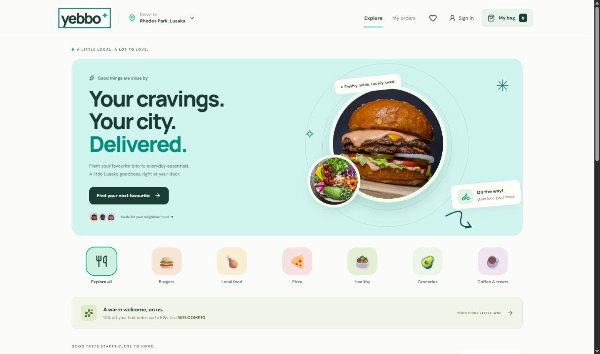

# Yebbo classroom demonstration

## Prepare once

Run `pnpm install` and `pnpm build` from the project folder. Start with `node scripts/present.mjs`, or double-click **Start Yebbo.cmd**. Open http://127.0.0.1:4000. Keep the startup window open.

The presentation has its own database, separate from development orders. For a clean rehearsal, stop the presentation server and run `node scripts/present.mjs --fresh`. This creates a new database and preserves earlier databases. Keep the same server running through the demonstration.

Photos require internet. Load the storefront and Burger Yard menu before presenting. If port 4000 is already occupied, stop the earlier Yebbo server before starting the presentation.

## Seven-minute presenter script

| Time | Show | Explain |
| --- | --- | --- |
| 0:00 | Explore page | “Yebbo connects Lusaka customers, shops and delivery riders. Prices are in kwacha.” |
| 0:45 | Burger Yard menu | Search a dish, show product prices and add The Yard Classic. |
| 1:30 | Customer checkout | Use the demo customer. Enter fictional address `12 Demo Road`, landmark `Classroom demonstration`, mobile `0971234567`, Rhodes Park. Apply WELCOME10 and choose cash. Explain that the server checks prices and stock. |
| 2:30 | Customer receipt | Show the K91.50 total, order number and initial timeline. |
| 3:00 | Merchant workspace | Accept the order, start preparation, then mark ready. |
| 4:00 | Admin workspace | Assign the ready order to Mwamba. |
| 4:45 | Rider workspace | Accept delivery, confirm pickup, confirm the simulated cash collection and complete delivery. |
| 5:45 | Customer order | Show delivered status and submit a review. |
| 6:15 | Admin overview | Show one completed order and report export. Merchandise K85; merchant payable K76.50; platform revenue K15 after the K8.50 discount. These are illustrative demo transactions. |

All demo accounts use **YebboDemo2026!**:

- customer@yebbo.test
- merchant@yebbo.test
- admin@yebbo.test
- rider@yebbo.test

Switch roles using Account → Sign out → Sign in. The sign-in dialog has demo-account buttons. Separate browser profiles can keep roles signed in simultaneously; ordinary tabs share the same session.

## One useful failure case

After the main walkthrough, create another order using a simulated mobile-money method and enable payment failure. Show that no order is placed. Alternatively, cancel a newly placed order with a reason. Keep this optional if presentation time is short.

## Answers to likely questions

**Where is the information stored?** In a local SQLite database. All four roles read the same records through a role-restricted API.

**Is it mobile?** The browser layout adapts to a phone, and the repository contains a native Expo client for iOS and Android. Signed installers and physical-device testing are separate work; demonstrate only the environment actually tested.

**Are the shops and payments real?** The shops and menu data are fictional. Mobile-money payments and cash collection are classroom simulations.

**How do you prevent incorrect totals?** The server calculates prices, fees and discounts from its own catalogue. It checks stock and rejects duplicate request keys containing different order details.

**What does the administrator analyse?** Stored orders provide completion rates, merchandise value, delivery duration, merchant payable, platform revenue and cancellation reasons. Revenue is before operating costs.

## Recovery during the presentation

If the page loses connection, confirm the startup window is still open, then refresh. If a transition is rejected, refresh the order and check which role is signed in. If WELCOME10 is already used, omit it or start a fresh rehearsal before the presentation. Do not restart with a fresh database halfway through an order.
